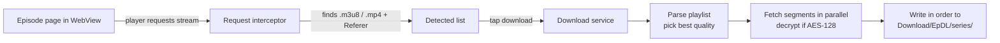

<div align="center">

# EpDL

**A tiny, fast Android app that detects the video playing on an episode page and saves it to your phone.**


</div>

---

## Overview

EpDL is a minimal browser with a download button. Open an episode page, press play, and EpDL spots the video stream the same way a download manager does. One tap saves it into a folder named after the series.

- **Lightweight:** plain Java and Android framework APIs only. No third-party libraries, so the APK stays well under 1 MB.
- **Fast:** parallel segment downloading with configurable speed.
- **Organised:** every series gets its own folder, and every file is named from the page link.
- **Built for episode URLs** like `https://aniwatch.lu/the-100-girlfriends-who-really-really-really-really-really-love-you-episode-1//`.

## Features

| | |
|---|---|
| **Floating controls** | Previous episode, download and next episode buttons float over the page. |
| **Automatic detection** | The download button turns green when a video stream is found. |
| **Smart naming** | `series-name-episode-1` becomes the file name, saved in a `series-name` folder. |
| **Parallel downloads** | Toggle fast mode (16 connections, several videos at once) or gentle mode (4 connections, one at a time). |
| **Redirect blocking** | Stops pages from redirecting you, opening popups or launching other apps. |
| **Set URL** | Jump to any episode and the app remembers where you left off. |
| **Wide stream support** | HLS (`.m3u8`), AES-128 encrypted streams, fMP4 and direct `.mp4` links. |
| **Background downloads** | Runs as a foreground service with a progress notification for each download. |
| **Fullscreen player** | Fullscreen video support, and Back steps through page history. |

## How it works



1. **Detection.** The page runs inside an Android `WebView`. `shouldInterceptRequest` sees every network request, including those made inside embedded players. Requests for `.m3u8` or `.mp4` files are recorded together with the `Referer` the player used.
2. **Download.** A foreground service fetches the playlist. For a master playlist it picks the highest bandwidth variant. It reads the AES-128 key and IV if present, and the fMP4 init segment if present.
3. **Speed.** Segments are downloaded by a pool of worker threads, decrypted, and written to disk in the correct order with a small look-ahead buffer.
4. **Saving.** The file is written through `MediaStore` to `Download/EpDL/<series>/`. No storage permission is needed. Failed downloads are cleaned up automatically.

## Installation

### Option 1: Download the APK
1. Open the **Actions** tab of this repository.
2. Open the latest successful run and download the **EpDL-apk** artifact.
3. Unzip it and install the APK. You may need to allow installs from unknown sources.

### Option 2: Build it yourself
Requirements: JDK 17, the Android SDK (API 34) and Gradle 8.7+.

```bash
git clone https://github.com/Rs_118/EpDL.git
cd EpDL
gradle assembleDebug
# APK: app/build/outputs/apk/debug/app-debug.apk
```

Or just fork the repository. The included GitHub Actions workflow (`.github/workflows/android.yml`) builds the APK on every push.

## Usage

1. Open EpDL and allow notifications when asked.
2. Tap **⋮** (top right) → **Set URL** and paste an episode link, for example `https://example.com/series-name-episode-1/`.
3. Press **play** on the video. The **↓** button turns **green** when the stream is detected.
4. Tap **↓** to download. If several streams are detected, for example an ad, you are asked which to save.
5. Use **◀** and **▶** to move between episodes.

Files are saved to:

```
Download/EpDL/series-name/series-name-episode-1.ts
```

### Menu options

| Option | What it does |
|---|---|
| **Set URL** | Open an episode. Links ending in `episode-` or `episode-/` start at episode 1. |
| **Block redirects** | On by default. Blocks site-initiated navigation, popups and external app links. Turn it off to browse normally. |
| **Parallel download** | On: 16 connections and multiple videos at once. Off: 4 connections and one video at a time. |
| **Reload** | Reloads the current page. |

## Supported streams

| Type | Support |
|---|---|
| HLS (`.m3u8`), including master playlists | Yes, best quality is picked |
| AES-128 encrypted HLS | Yes |
| fMP4 HLS (saved as `.mp4`) | Yes |
| Direct `.mp4` links | Yes |
| TS segments with fake image headers | Yes |
| DRM protected streams (Widevine and similar) | No |
| Other encryption (SAMPLE-AES) | No |

HLS videos are saved as `.ts`, which VLC, MX Player and most video players open directly.

## Troubleshooting

| Problem | Fix |
|---|---|
| Button stays red | Press play first. The stream is only requested once the player starts. Some pages need a different server selected. |
| Download fails or stops partway | Turn **Parallel download** off. Some hosts limit simultaneous connections. Then try again. |
| Page does nothing when tapped | **Block redirects** may be blocking it. Turn it off in the menu. |
| Wrong video picked | Choose the correct one from the list when asked. Ads usually appear as extra entries. |
| Won't install | Allow installs from unknown sources for your browser or file manager. |

## Project structure

```
EpDL/
├── .github/workflows/android.yml     CI build
├── app/src/main/
│   ├── AndroidManifest.xml
│   └── java/com/epdl/app/
│       ├── MainActivity.java         WebView, floating buttons, menu, stream detection
│       └── DlService.java            Foreground service and HLS downloader
├── app/build.gradle
├── build.gradle
└── settings.gradle
```

## Roadmap

- Optional MP4 conversion for finished downloads
- Download queue with pause and resume
- Custom app icon and light/dark themes

## Disclaimer

EpDL is a general purpose tool for saving media you have the right to save. You are responsible for following the laws of your country and the terms of any site you use it on. The authors do not host, provide or endorse any content, and are not affiliated with any website.

## License

Released under the [MIT License](LICENSE).
